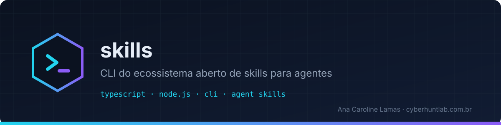

<p align="center"></p>

# skills — CLI para instalar e gerenciar skills de agentes de código

Cópia do projeto de código aberto **[skills](https://github.com/vercel-labs/skills)**, da Vercel Labs: uma **CLI em TypeScript** que instala, usa, atualiza e remove **skills de agentes** (arquivos `SKILL.md` com instruções reutilizáveis) em dezenas de agentes de código, como OpenCode, Claude Code, Codex, Cursor e Gemini CLI.

Documentação original em inglês, com a lista completa de agentes: [README-en.md](README-en.md).

## Recursos

- **Instalar skills** de repositórios GitHub, GitLab, Azure Repos, qualquer URL Git ou pasta local, incluindo repositórios privados, usando a autenticação já configurada.
- **Usar sem instalar** (`skills use`): gera o prompt de uma skill numa pasta temporária ou abre um agente já com ele.
- **Escopo do projeto ou global** (`-g`) e instalação por **symlink** (recomendado) ou **cópia**.
- **Outros comandos**: `list`, `find`, `update`, `remove` e `init` (cria um modelo de `SKILL.md`).
- **Descoberta** de skills e de manifestos de plugin nos repositórios.

## Instalação

Requisitos: **Node.js 20+**. Para usar, não precisa clonar:

```bash
npx skills add vercel-labs/agent-skills
```

Para desenvolver a partir deste repositório:

```bash
git clone https://github.com/ticarollamas-arch/skills-main.git
cd skills-main
pnpm install
pnpm dev --help
```

## Como usar

| Comando | Função |
|---|---|
| `npx skills add <origem>` | Instala skills de um repositório ou pasta |
| `npx skills use <origem>` | Usa uma skill sem instalar |
| `npx skills list` | Lista as skills instaladas |
| `npx skills find [termo]` | Procura skills |
| `npx skills update [skills]` | Atualiza as skills instaladas |
| `npx skills remove [skills]` | Remove skills dos agentes |
| `npx skills init [nome]` | Cria um modelo de `SKILL.md` |

Opções úteis de `add`: `-g` (global), `-a <agentes>`, `-s <skills>`, `-l` (só listar), `--copy`, `-y` e `--all`.

### Variáveis de ambiente

| Variável | Uso |
|---|---|
| `INSTALL_INTERNAL_SKILLS` | `1` ou `true` mostra e instala skills marcadas como internas |
| `DISABLE_TELEMETRY` / `DO_NOT_TRACK` | Desativam a telemetria anônima |
| `GITHUB_TOKEN` / `GH_TOKEN` | Token para requisições autenticadas à API do GitHub |

### Desenvolvimento

```bash
pnpm test          # testes (Vitest)
pnpm type-check    # tsc --noEmit
pnpm build         # gera licenças de terceiros e o build
```

## Telemetria

A CLI coleta dados de uso anônimos. Para desativar, defina `DISABLE_TELEMETRY=1` ou `DO_NOT_TRACK=1`.

## Tecnologias

TypeScript · Node.js · pnpm · Vitest · obuild · @clack/prompts · simple-git · yaml · tar

## Créditos

Projeto original: [vercel-labs/skills](https://github.com/vercel-labs/skills), da Vercel, Inc. O aviso de copyright está preservado em [LICENSE](LICENSE), e os avisos de terceiros em [ThirdPartyNoticeText.txt](ThirdPartyNoticeText.txt).

## Licença

MIT. Veja [LICENSE](LICENSE) (Copyright © 2026 Vercel, Inc.).
